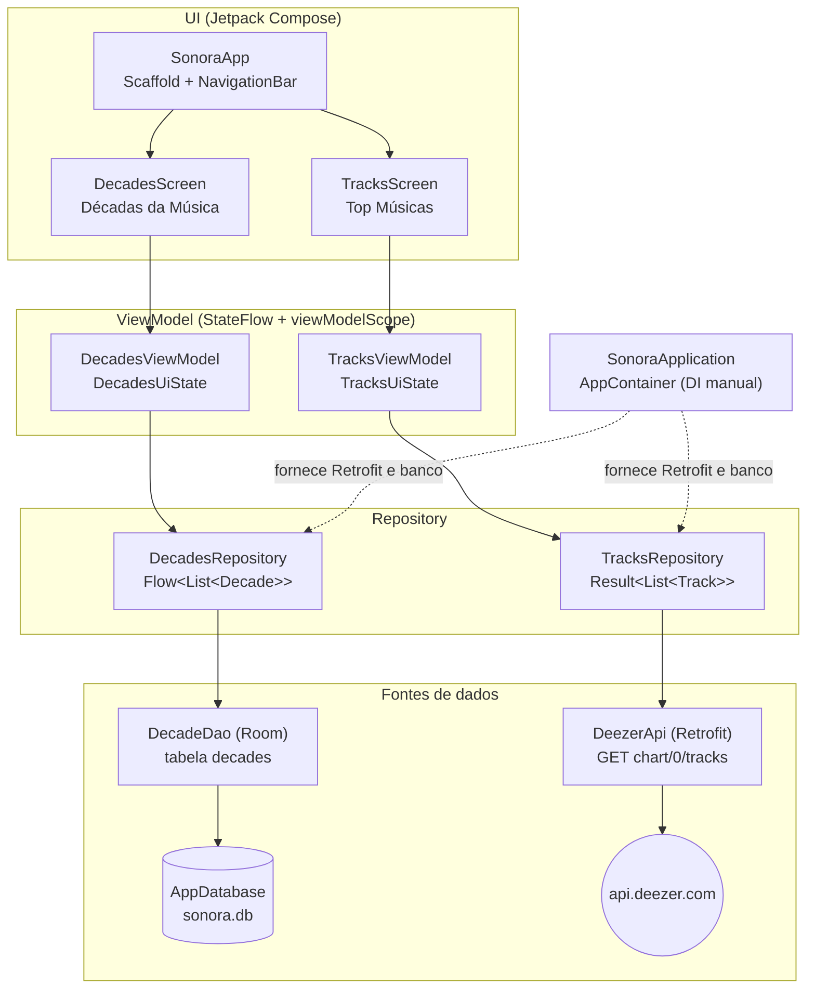

# Arquitetura do Sonora

App Android de música (Kotlin + Jetpack Compose + Material 3), organizado em
**MVVM + Repository**, com pacotes **por feature**. Cada integrante do grupo
adiciona a sua própria feature (`feature/<nome>/`) com 2 telas, sua tabela no
Room e sua rota da API, sem precisar alterar o código dos outros.

Todas as telas são **somente de consulta e exibição** (sem cadastro, login,
edição ou exclusão).

## Diagrama



Fluxo de dados: a UI coleta o `StateFlow` do ViewModel com
`collectAsStateWithLifecycle()`. O ViewModel chama o Repository dentro de
`viewModelScope`. O Repository usa `suspend fun` (Retrofit) ou `Flow` (Room) e
converte DTOs/entities para modelos de domínio. Erros de rede são tratados no
Repository e chegam à UI como `UiState.Error`.

## Estrutura de pacotes

```
com.example.sonora
├── SonoraApplication.kt          # Application: cria o AppContainer
├── MainActivity.kt               # setContent { SonoraApp() }
├── core/
│   ├── di/AppContainer.kt        # injeção manual: Retrofit, AppDatabase, repositórios
│   ├── network/NetworkModule.kt  # OkHttp + logging + Retrofit (base URL da Deezer)
│   ├── database/AppDatabase.kt   # banco único; cada integrante registra sua entity/DAO
│   ├── navigation/
│   │   ├── TopLevelDestination.kt  # abas da NavigationBar
│   │   └── SonoraApp.kt            # Scaffold + NavigationBar + NavHost
│   └── ui/
│       ├── components/StateViews.kt  # Loading / Erro / Vazio reutilizáveis
│       └── theme/                    # Color, Theme (escuro), Type
└── feature/
    ├── tracks/                   # Integrante 1 — Retrofit
    │   ├── data/
    │   │   ├── remote/DeezerApi.kt
    │   │   ├── remote/dto/ChartTracksResponse.kt
    │   │   ├── model/Track.kt
    │   │   └── TracksRepository.kt
    │   └── ui/
    │       ├── TracksUiState.kt
    │       ├── TracksViewModel.kt
    │       └── TracksScreen.kt
    └── decades/                  # Integrante 1 — Room
        ├── data/
        │   ├── local/DecadeEntity.kt
        │   ├── local/DecadeDao.kt
        │   ├── local/DecadesSeed.kt   # seed inicial (RoomDatabase.Callback.onCreate)
        │   ├── model/Decade.kt
        │   └── DecadesRepository.kt
        └── ui/
            ├── DecadesUiState.kt
            ├── DecadesViewModel.kt
            └── DecadesScreen.kt
```

### Como outro integrante adiciona a sua feature

1. Criar `feature/<nome>/data` e `feature/<nome>/ui`.
2. **Room:** criar a sua `@Entity` e o seu `@Dao`; em `AppDatabase` acrescentar a
   entity em `entities = [...]`, uma `abstract fun <nome>Dao()` e **subir a
   `version`** (com `Migration` ou `fallbackToDestructiveMigration`). Se tiver
   seed, adicionar a chamada em `AppDatabase.SeedCallback`.
3. **Retrofit:** criar a própria interface (ex.: `AlbumsApi`) e obtê-la com
   `container.retrofit.create(AlbumsApi::class.java)`.
4. Expor o repositório em `AppContainer`.
5. Adicionar uma entrada em `TopLevelDestination` e um `composable(...)` no
   `NavHost` de `SonoraApp`.

## Dependências e versões

Versões confirmadas no Maven Central / Google Maven e compatíveis com o
AGP 8.7.3 e Kotlin 2.0.21 já usados pelo projeto.

| Biblioteca | Artefato | Versão |
|---|---|---|
| Android Gradle Plugin | `com.android.application` | 8.7.3 |
| Kotlin | `org.jetbrains.kotlin.android` / `plugin.compose` | 2.0.21 |
| KSP | `com.google.devtools.ksp` | 2.0.21-1.0.28 |
| Compose BOM | `androidx.compose:compose-bom` | 2024.12.01 |
| Material 3 | `androidx.compose.material3:material3` | (BOM) |
| Activity Compose | `androidx.activity:activity-compose` | 1.9.3 |
| Lifecycle (runtime, ViewModel Compose, runtime Compose) | `androidx.lifecycle:*` | 2.8.7 |
| Navigation Compose | `androidx.navigation:navigation-compose` | 2.8.5 |
| Coroutines | `org.jetbrains.kotlinx:kotlinx-coroutines-android` | 1.9.0 |
| Retrofit | `com.squareup.retrofit2:retrofit` | 2.11.0 |
| Conversor Gson | `com.squareup.retrofit2:converter-gson` | 2.11.0 |
| OkHttp Logging | `com.squareup.okhttp3:logging-interceptor` | 4.12.0 |
| Room (runtime, ktx, compiler via KSP) | `androidx.room:*` | 2.6.1 |
| Coil (Compose) | `io.coil-kt:coil-compose` | 2.7.0 |

Sem Hilt/Dagger: a injeção é manual via `SonoraApplication` → `AppContainer`.
O schema do Room é exportado em `app/schemas/` (`exportSchema = true`).

## API utilizada (Integrante 1)

`GET https://api.deezer.com/chart/0/tracks` (sem chave). Resposta validada
com curl:

```json
{
  "data": [
    {
      "id": 4337389322,
      "title": "Pós (Ao Vivo)",
      "duration": 175,
      "position": 1,
      "preview": "https://cdnt-preview.dzcdn.net/...mp3",
      "artist": { "id": 172071177, "name": "Felipe e Rodrigo", "...": "..." },
      "album": {
        "id": 1117358492,
        "title": "Pós (Ao Vivo)",
        "cover_medium": "https://cdn-images.dzcdn.net/.../250x250-000000-80-0-0.jpg",
        "cover_big": "https://cdn-images.dzcdn.net/.../500x500-000000-80-0-0.jpg"
      }
    }
  ],
  "total": 10
}
```

Em caso de falha a Deezer responde **HTTP 200** com
`{"error": {"type": "...", "message": "...", "code": 0}}`, por isso o
Repository também verifica esse campo.
